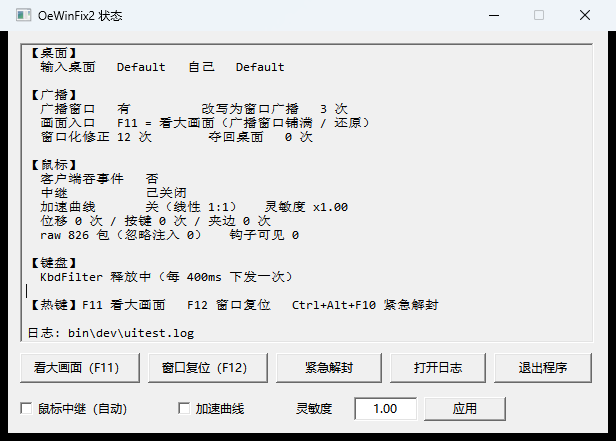

<div align="center">

# OSeasy-Tool

**Os-Easy 多媒体网络教室 · 学生端修复工具**

把全屏广播变成能拖动缩放的普通窗口 &nbsp;·&nbsp; 让键盘鼠标重新可用

[](LICENSE)
[](#构建)
[-success.svg)](#构建)
[](#构建)

</div>

上课广播时，学生端会做几件"接管你机器"的事：把**输入桌面**切到 `NetTeachingDesktop`、
装 `WH_MOUSE_LL` 把真实鼠标事件吞掉、用 `KbFilter.sys` 驱动级锁键盘、把广播窗口全屏置顶。
结果就是那句熟悉的"上课了，机器不属于你了"。

OSeasy-Tool 只回头做两件事：**广播窗口 → 普通窗口**、**键盘鼠标救活**。

不改客户端任何文件，不打内存补丁，不结束 / 不挂起学生端进程。

## 目录

- [功能](#功能)
- [截图](#截图)
- [快速开始](#快速开始)
- [使用](#使用)
- [工作原理](#工作原理)
- [安全阀与边界](#安全阀与边界)
- [构建](#构建)
- [测试与验证](#测试与验证)
- [仓库结构](#仓库结构)
- [贡献](#贡献)
- [许可证](#许可证)
- [致谢](#致谢)

---

## 功能

| 功能 | 默认 | 干什么 |
|---|---|---|
| **窗口化** | 开 | 广播窗口去掉 `WS_EX_TOPMOST` / `WS_POPUP`、补 `WS_CAPTION`、改成工作区 80% 居中；200ms 周期纠正，被客户端抢回去就再掰回来 |
| **键盘解锁** | 开 | 每 400ms 向 `\\.\OeKbdFilter` 下发释放 IOCTL `0x000B2008` |
| **鼠标中继** | 开（按需） | 每 5 秒差分探测；**只有证明客户端在吞事件**才装钩子接管，接管方式是 `SetCursorPos` 直驱光标 |
| **输入桌面夺回** | 开 | 250ms 检查输入桌面，发现被切到教学桌面就 `SwitchDesktop` 拿回来 |
| **B 方案：广播改写** | 开 | 读到 `ScreenRender.exe` 命令行里的 `#fullscreen#:1`，结束它并用同一条参数（`:1` → `:0`）重拉，从源头避免"锁键鼠 + 切桌面" |
| **看大画面** | 热键 `F11` | 广播窗口在工作区内铺满 ↔ 还原（不切桌面） |
| **窗口复位** | 热键 `F12` | 把广播窗口摆成工作区 80% 居中 |
| **紧急解封** | `Ctrl+Alt+F10` | 窗口复位 + 键盘释放 + 夺回桌面 + 接管鼠标，一把梭 |
| **状态面板** | 启动弹一次 | 桌面 / 广播 / 鼠标 / 键盘四段实时状态 + 开关 + 退出 |

## 截图



## 快速开始

### 直接用

1. 拿到 `bin\OSeasy-Tool.exe`（或者自己[构建](#构建)一份，静态 CRT、拷一个 exe 就能跑）
2. **双击运行** —— 需要管理员权限（清单里已声明 `requireAdministrator`：要下发键盘 IOCTL、要向高完整性窗口注入输入）
3. 托盘出现图标，状态面板会自动弹一次

托盘图标被 Windows 收进"隐藏的图标"里了？不依赖托盘也能操作：

```bat
OSeasy-Tool.exe --panel    :: 把已在运行的实例的面板叫出来
OSeasy-Tool.exe --quit     :: 让已在运行的实例正常退出
```

### 从源码构建

```bat
build.bat
bin\OSeasy-Tool.exe
```

需要 MSVC（VS2019 / 2022 / 2026 都行 —— 脚本用 `vswhere` 自动找工具链，也可以用
`set OST_VCVARS=<你的 vcvarsall.bat 路径>` 手动指定）。详见[构建](#构建)。

---

## 使用

### 托盘菜单

| 菜单项 | 说明 |
|---|---|
| 显示状态面板 | 同双击图标 |
| 窗口复位 | 摆成工作区 80% 居中（=`F12`） |
| 看大画面 | 广播窗口铺满 ↔ 还原（=`F11`） |
| **紧急解封** | 窗口复位 + 键盘释放 + 夺回桌面 + 接管鼠标（=`Ctrl+Alt+F10`） |
| 鼠标中继（自动） | 勾选状态 = 允许按需接管；取消 = 完全交给系统 |
| 鼠标加速曲线 | 关（默认）= 线性 1:1；开 = 复刻系统"提高指针精确度" |
| 全屏广播改写 | B 方案总开关 |
| 打开日志目录 / 退出程序 | —— |

### 热键

| 热键 | 作用 | 说明 |
|---|---|---|
| `F11` | 看大画面 | **裸键、全局抢占**：浏览器 F11 全屏、游戏全屏都会被抢；抢不到注册时自动退回 `Ctrl+Alt+F11` |
| `F12` | 窗口复位 | 同上，抢不到时退回 `Ctrl+Alt+F12` |
| `Ctrl+Alt+F10` | 紧急解封 | 故意带修饰键，避免误触 |

全部走 `RegisterHotKey`（系统级）+ `MOD_NOREPEAT`（长按不连发）。面板底部会显示**实际生效**的那套组合键，
注册失败也不会有"按钮点了没反应"的错觉 —— 日志里写清楚了。

### 状态面板

[上面那张图](#截图)就是它。双击托盘图标打开，**启动时也自动弹一次**；它有任务栏按钮、也在 `Alt+Tab` 里
  （早年用 `WS_EX_TOOLWINDOW` 做成"工具窗口"，结果托盘图标一被收进"隐藏的图标"就彻底找不到界面了）
* 500ms 自己刷新，纯 Win32 子控件 —— 没有 `.rc`、没有 `comctl32`、没有额外依赖
* 按钮：看大画面（F11） / 窗口复位（F12） / 紧急解封 / 打开日志 / 退出程序
  （第一个按钮在 B 方案失效时会自动变回"切到课堂桌面"）
* 底排开关：鼠标中继（自动）、加速曲线、灵敏度（改完点"应用"，写 `HKCU`，下次启动生效）
* `WM_CLOSE` **只认前台来源** —— 广播期间客户端会给不相关窗口群发 `WM_CLOSE`（实测能刷到 0.5 秒一次），
  面板不会被它关掉；你自己点 X 时窗口一定已激活，所以两边都不误伤

### 命令行

```bat
OSeasy-Tool.exe --status            :: 打印状态后退出
OSeasy-Tool.exe --windowize-now     :: 立刻窗口化一次后退出
OSeasy-Tool.exe --quit              :: 让已在运行的实例正常退出
OSeasy-Tool.exe --panel             :: 让已在运行的实例弹出状态面板
OSeasy-Tool.exe --no-panel          :: 启动时不弹面板（默认会弹）
OSeasy-Tool.exe --once              :: 各线程跑一轮自检（脚本里用）
OSeasy-Tool.exe --no-relay          :: 只要窗口化 + 键盘 + 桌面（鼠标交给系统）
OSeasy-Tool.exe --relay-force       :: 不等探测，直接接管鼠标中继（测试用）
OSeasy-Tool.exe --accel on          :: 加速曲线打开（默认关 = 线性、灵敏度低）
OSeasy-Tool.exe --sens 1.5          :: 灵敏度倍数（默认 1.0 = 设备计数与像素 1:1）
OSeasy-Tool.exe --no-windowize      :: 不做窗口化
OSeasy-Tool.exe --no-desktop        :: 不夺回输入桌面
OSeasy-Tool.exe --no-kbd            :: 不做键盘释放
OSeasy-Tool.exe --no-bcast-fix      :: 关掉 B 方案（广播改写）
OSeasy-Tool.exe --interval 200      :: 窗口化纠正周期(ms)
OSeasy-Tool.exe --desktop-interval 250  :: 桌面检测周期(ms)
OSeasy-Tool.exe --kbd-interval 400  :: 键盘释放周期(ms)
OSeasy-Tool.exe --w 1280 --h 720    :: 窗口化后的尺寸（默认工作区 80%）
OSeasy-Tool.exe --x 100 --y 100     :: 窗口化后的位置（默认居中）
OSeasy-Tool.exe --resize            :: 允许守护自动改尺寸位置（默认只修样式，手动窗口化不受影响）
OSeasy-Tool.exe --no-tray           :: 不加托盘图标（配合 --once 或脚本用）
OSeasy-Tool.exe --verbose           :: 详细日志
OSeasy-Tool.exe --log D:\ost.log   :: 指定日志文件
OSeasy-Tool.exe --help              :: 全部开关
```

### 常见问题

**找不到托盘图标 / 双击 exe 只弹了个框？**
程序是**单实例**的：已经在跑的时候再双击，会把已有实例的面板叫出来
（`PostMessage` 请它弹面板，再用"面板窗口是否真的出现"确认 —— 早期用命名事件 ACK，实测偶发收不到）。
资源管理器重启后通知区会被重建，程序收到 `TaskbarCreated` 会自己把图标补回去。
实在找不到就用 `--panel` / `--quit`，面板右下角也有"退出程序"。

**按 F11 出来的是浏览器全屏？**
裸键是全局抢占，注册顺序看谁先到。我们抢不到时会自动退回 `Ctrl+Alt+F11`，面板底部显示真实生效的组合。

**窗口化成功但鼠标还是死的？**
正常 —— B 方案只把广播搬回你桌面，**不会**让客户端卸掉它的鼠标钩子。那一层由中继处理：
5 秒探测到"普通注入不动、`0x12452` 能动"就接管，接管后指针靠 `SetCursorPos` 直驱，零排队。
如果连中继也没接管，看面板里"客户端吞事件"是不是"否"。

**上课中途键盘鼠标同时死了？**
按 `Ctrl+Alt+F10`（或面板"紧急解封"）：窗口复位 → 键盘释放 → 夺回桌面 → 接管鼠标，一次做完。

---

## 工作原理

### 三层对策

| 层 | 现象 | 本程序的对策 | 实测依据 |
|---|---|---|---|
| **输入归属** | 广播时客户端把**输入桌面**切到 `NetTeachingDesktop`，你自己的桌面收不到任何鼠标键盘输入 | 250ms 检测，发现不是自己的桌面就 `SwitchDesktop` 夺回 | 旧项目日志 299 次采样 `inputDesktop=NetTeachingDesktop` |
| **鼠标被吞** | 客户端装 `WH_MOUSE_LL`，只放行 `dwExtraInfo == 0x12452`，其余真实鼠标事件 `return 1` 吞掉 | 自己的钩子抢先丢弃原件 + 从 **Raw Input** 取设备原始增量 + **`SetCursorPos` 直驱光标** | 广播中注入 `extraInfo=0` 位移 0、`0x12452` 位移 97,60；直驱后零延迟 |
| **键盘被锁** | `KbFilter.sys` 驱动级封锁 | 每 400ms 向 `\\.\OeKbdFilter` 下发释放 IOCTL `0x000B2008` | 旧项目实测 `sent OK` 后键盘立即恢复 |

> **没有"镜像窗口"这一层了**（2026-10-20 删除）：B 方案把广播窗口搬回你自己的桌面以后，
> 镜像只是同一幅画面出现两次 —— 没有使用场景。那份 `PrintWindow` 的实测数据还留在
> [`docs/evidence.md`](docs/evidence.md) §7，代码在 git 历史里可查。

### B 方案：全屏广播 → 窗口广播

不去对抗"广播进来以后"的锁，而是**在客户端启动渲染器的那一刻把参数改掉**。

* 渲染器 `ScreenRender.exe` 的**命令行**里带着整条广播参数：
  `{#decoderName#:#h264#,#fullscreen#:1,#local#:#10.69.46.23#,#port#:7778,...}`
* 我们自己用这行参数拉起客户端的 `ScreenRender.exe` 就能正常渲染老师画面
  （[截图](docs/bcast-self-launch.png)）—— **不需要替换客户端的任何文件**
* 全屏广播（`#fullscreen#:1`）才带来"锁键鼠 + 切桌面"；窗口广播的会话里客户端不上锁

`src/bcast.cpp` 的做法：

1. 每秒枚举 `ScreenRender.exe`，用 `NtQueryInformationProcess(ProcessCommandLineInformation)` 读命令行；
2. 只挑含 `#fullscreen#:1` 的实例 → `TerminateProcess` 结束它；
3. 用**同一条命令行**（只把 `:1` 换成 `:0`，等长替换不破坏引号）`CreateProcessW` 重新拉起；
4. 防抖：一分钟最多 8 次；只动全屏实例；自己拉起的 pid 绝不误杀。

### 鼠标：探测驱动 + 直驱光标

**探测**：每 5 秒做一次差分探测 —— 普通注入 3px 动不了、`0x12452` 注入 3px 能动，才判定"客户端在吞事件"，
此时才装钩子接管。客户端没吞的时候完全透明（零钩子、零注入、零延迟）。

**接管时**：钩子线程只做 `return 1`（不睡、不写盘、不探测、不注入）—— 低级钩子是同步的，
装钩线程一阻塞，**全系统鼠标跟着停**，这是旧版"卡"的根因。位移从 Raw Input 取设备增量，
用 `SetCursorPos` 直接设绝对坐标：不进钩子链、不排队，一次调用立即到位。
按键仍然走 `SendInput`（必须作为真实输入事件送达窗口），带 `0x12452` 标记。

**加速曲线（开关，默认关）**：系统"提高指针精确度"会按速度放大位移（本机阈值 `6/10` → x2/x4）。
直驱绕过了它，于是自己复刻：把移动量按 dt 归一成"每 10ms 的计数"当速度再比阈值 ——
不除以 dt 的话慢速也会被判成高速（实测 `x4` 命中 264/277，指针会飞）。
选择存 `HKCU\Software\OSeasy-Tool\MouseAccel`，重启保留。

### 看大画面（F11）—— 为什么不切桌面

B 方案把"全屏广播"改写成"你桌面上的一个窗口"，所以**教学桌面上已经没有广播窗口了**。
这时切过去只会看到空桌面 —— 不是按钮坏了，是那儿真的没东西（实测：`EnumDesktopWindows`
在 `NetTeachingDesktop` 上找不到 `MultiRenderWindowClass`）。

所以 F11 换成这件事：**把广播窗口在工作区内铺满 / 还原**。

* 铺满：覆盖整个工作区（不盖任务栏），带 `SWP_NOSENDCHANGING`，否则客户端会在
  `WM_WINDOWPOSCHANGING` 里把尺寸顶回去（实测）
* 还原：回到按 F11 之前的位置尺寸；之前没有有效矩形时用"工作区 80% 居中"
* 不切桌面 → 面板、任务栏、其它窗口全都在原位，鼠标键盘也不用跨桌面

只有在 B 方案失效（广播窗口真的占着教学桌面）时，同一个按钮 / F11 才会变回"切到课堂桌面"，
并且切过去之后**暂停 60 秒自动夺回**（`DesktopHoldReclaim`）—— 否则 250ms 就被拉回来，看起来像没反应。

### 五条踩过的坑

* **不要改客户端内存**：主客户端 `Student.exe` 被 `ProcFireWall` 驱动保护，`OpenProcess` 返回 5，连它的模块表都读不到。
* **鼠标位移不要用 `SendInput` 逐事件重放**：补出来的事件必须**穿过客户端的低级钩子**才生效，钩子链是串行的；
  125Hz+ 鼠标时发送速度超过链条消化速度，事件就在输入队列里积压 —— 总位移没错但被匀速排空，
  观感是"实际移了一大段、指针在后面慢慢追上来"（像远程桌面）。同一段操作：旧法 5 秒往链上塞 **975** 个事件，
  `SetCursorPos` 直驱只有 **4** 个（全是别人发的）。
* **不要逐事件复刻绝对坐标**：事件被吞时坐标**不累积**（实测 6 步只走 22px，白名单对照 165px）。
* **只信物理设备的 Raw Input**：`hDevice == NULL` 的是注入输入（**包括我们自己注入的**）。不过滤就会形成反馈环，把指针顶死在屏幕角落。
* **锁边要连虚拟位置一起夹**：撞到屏幕边缘时不夹住内部坐标，回头会先"还债"，表现为反向不动一下。

更多数据（299 次桌面采样、钩子字节、`PrintWindow` 实测…）见 [`docs/evidence.md`](docs/evidence.md)。

---

## 安全阀与边界

**安全阀**（任一触发都不会让鼠标变死）：

* 只有"raw 通路就绪"**且**"正在接管"才丢弃原始事件；
* 输入桌面不是自己的就停手；
* 连续设置光标失败 30 次就停手；
* 广播窗口消失后自动停止接管并卸钩子。

**有意不做的事**：

* 不结束、不挂起学生端进程，不动 `MMPC` 服务，不碰 `ProcFireWall` / `FbdATS` 驱动；
* 不做内存补丁（主客户端打不进去，见上）；
* 不改客户端任何文件，不做登录自启计划任务（需要就说，功能很小但没必要默认塞进来）；
* **不做"切到教学桌面看广播"**：B 方案生效时那个桌面是空的；看大画面用 F11 让窗口铺满；
* 不接管桌面锁定（`systemoper!SYS_LockScreen` 那条链路是另一回事）；
* **不做镜像窗口**（2026-10-20 删除）：B 方案生效后广播窗口就在你自己的桌面上，再镜像一份等于同一幅画面出现两次。

---

## 构建

```bat
build.bat                        :: 编主程序 + 三个 dev 工具
build.bat OSeasy-Tool.new.exe      :: 主程序正在运行时，先编到别名，之后再换（见 swap.bat）
```

产物：

| 文件 | 是什么 |
|---|---|
| `bin\OSeasy-Tool.exe` | **就是程序**，双击它 |
| `bin\dev\FakeBox.exe` | 回归测试替身（加载真实 `StudentLogic.dll` 的钩子） |
| `bin\dev\relaytest.exe` | 中继独立自检 |
| `bin\dev\uitest.exe` | 只画面板，验收界面用 |
| `bin\obj\` | 编译中间物，可随手整个删掉 |

静态 CRT、x86、只依赖系统 DLL。**版本管理交给 git**：`bin\` 里不再堆 `*.prev.exe`，
回滚 = `git checkout <tag>` → `build.bat` → `swap.bat`。

**换装**（主程序正在跑、又不能杀它时）：

```bat
build.bat OSeasy-Tool.new.exe     :: 1) 编到别名
swap.bat                        :: 2) 退出托盘程序后运行：换新 exe -> 启动
```

`swap.bat` **不会**替你结束正在跑的守护进程；检测到在跑就只打印提示。

## 测试与验证

> 别在有课的时候跑 —— 它会结束进程、接管鼠标。

```powershell
powershell -ExecutionPolicy Bypass -File test\check.ps1
```

`bin\dev\FakeBox.exe` 会加载**真实的 `StudentLogic.dll`**、用它自己的钩子过程（RVA `0x80190`）装
`WH_MOUSE_LL`，再建一个同名窗口类的全屏置顶窗口 —— "鼠标锁"这一层跑的是客户端原件，不是仿写。

断言清单：

```
A0 fake broadcast window exists
A1 plain event swallowed by client hook (moved=0)
A2 whitelisted 0x12452 passes (moved>0)
B1..B4 windowize: TOPMOST/POPUP 清除、补标题栏、不再是全屏尺寸
C1 relay 接管中 0x12452 依然放行（回归：曾经连白名单都被冻住）
D1 relay 状态 -> 接管中（探测到客户端在吞事件）
D2 注入包被忽略（hDevice 过滤，无反馈环）
D3 keyboard release IOCTL OK
```

（脚本注入的都是"注入输入"，所以 `位移` 计数在自动化里是 0 —— 位移只有**真的用手移动鼠标**才会增长，
这条用 `bin\dev\relaytest.exe` 或直接看状态面板验证。）

不需要 FakeBox、也不动主程序的独立自检：

```bat
bin\dev\relaytest.exe        :: 装钩子 -> 探测 -> 接管 -> 打印 8 秒统计 -> 卸载并干净退出
```

## 仓库结构

```
src/facts.h        实测常量 + 证据索引（改代码前先读这个）
src/log.*          日志（控制台 + 文件）
src/util.*         权限 / 桌面名 / 进程名 / 单实例 / 线程注册
src/windowize.*    目标①：广播窗口窗口化（含跨桌面、最小化感知、防抖动）
src/desktop.*      输入桌面夺回
src/kbd.*          键盘封锁解除
src/bcast.*        B 方案：检测 ScreenRender.exe 的 #fullscreen#:1 -> 改写重拉为 :0
src/relay.*        目标②：鼠标中继（探测驱动 + 直驱光标 + 加速开关）
src/statusui.*     状态面板（纯 Win32 子控件，500ms 刷新）
src/main.cpp       单表 CLI + 托盘 + 热键
test/FakeBox.cpp   测试替身（真客户端钩子）
test/relaytest.cpp 中继的独立自检
test/uitest.cpp    只画面板的壳（把其它模块换成桩，专门验收界面）
test/check.ps1     回归断言（ASCII-only：PowerShell 5.1 按 ANSI 读脚本）
docs/evidence.md   全部实测数据与原始证据索引
docs/status-panel.png     面板截图
LICENSE            MIT 许可（只有这一份，源码里不塞逐文件版权头）
```

## 贡献

欢迎 issue / PR，但这个仓库有两条硬规矩：

1. **先读 [`src/facts.h`](src/facts.h)**。里面每一条都是实测结论，重写代码可以，重写结论不行。
   新增行为请附证据（日志片段、截图、复现步骤），"我觉得应该这样"的补丁会被打回。
2. **`.bat` / `.ps1` 保持 ASCII-only**：PowerShell 5.1 按 ANSI 读脚本，`build.bat` 也一样，
   中文注释在这里会变成乱码甚至语法错误。中文留给 `.cpp` / `.md`。
3. 提交信息用中文写清"**为什么**改"，别只写"优化""修复"。

改完请跑一遍 `test\check.ps1`，并在有真实客户端的环境里至少验证一次窗口化 + 键鼠。

## 许可证

[MIT](LICENSE)，Copyright (c) 2026 handsomedog。就是那句大白话：

* **能拿去用**：个人、学校、公司，改完再闭源发，都不用问、不用署名到界面里、不用交钱；
* **唯一的义务**：分发二进制或源码时，把 `LICENSE` 里那段版权声明和许可声明一起带上；
* **不担保**：按现状提供。这程序会改广播参数、结束并重拉 `ScreenRender.exe`、下发键盘 IOCTL、接管鼠标光标 ——
  上机前自己看清楚它干什么。

两个边角，说清楚免得含糊：

* 参考项目 [OsEasy-ToolBox](https://github.com/ZiHaoSaMa66/OsEasy-ToolBox) 是**别人**的实现，本仓库
  **不包含它的任何代码副本**（只在上面的致谢里留链接），版权归原作者，不适用本仓库的 MIT；
  要抄它的代码请自己去看它那边的声明。
* 教学系统客户端本身（`Student.exe` / `ScreenRender.exe` / `KbFilter.sys` 等）与本项目无关，
  本项目不重新分发、也不修改它，MIT 自然不覆盖它。

## 致谢

* [OsEasy-ToolBox](https://github.com/ZiHaoSaMa66/OsEasy-ToolBox) —— B 方案（全屏广播改写成窗口广播）
  的启发来源。本仓库**不再放它的副本**，要看实现请直接去原仓库；
* 旧项目 `OeWinFix` 留下的全套实测日志 —— 没有那些数据，这个版本只能瞎猜。
